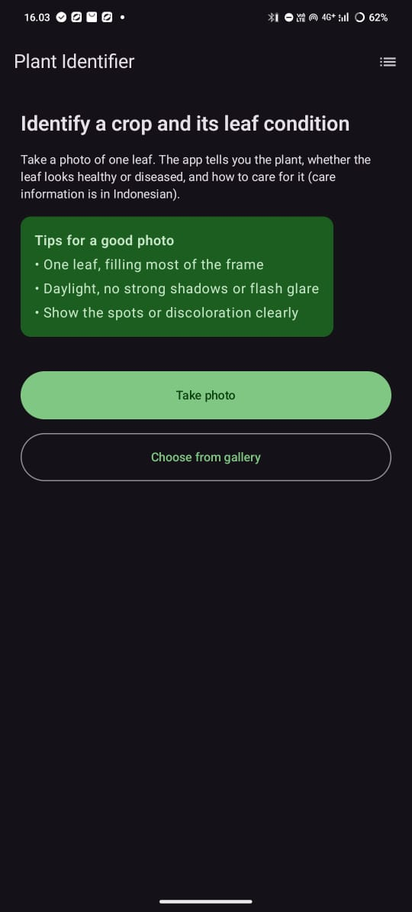
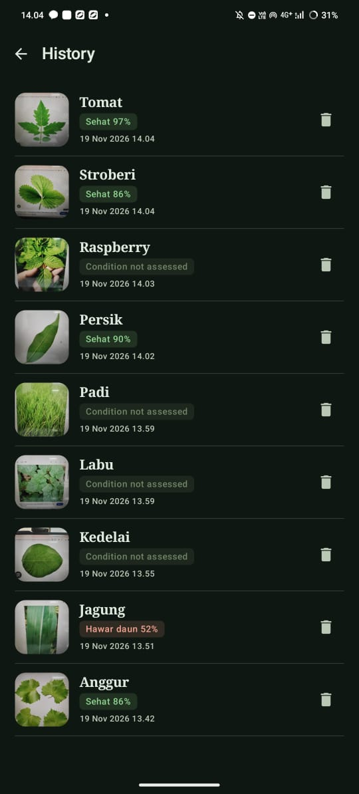
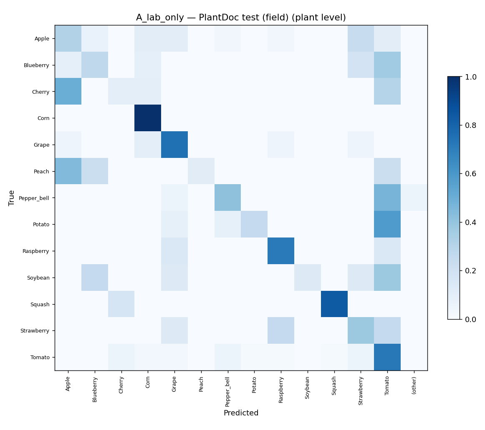
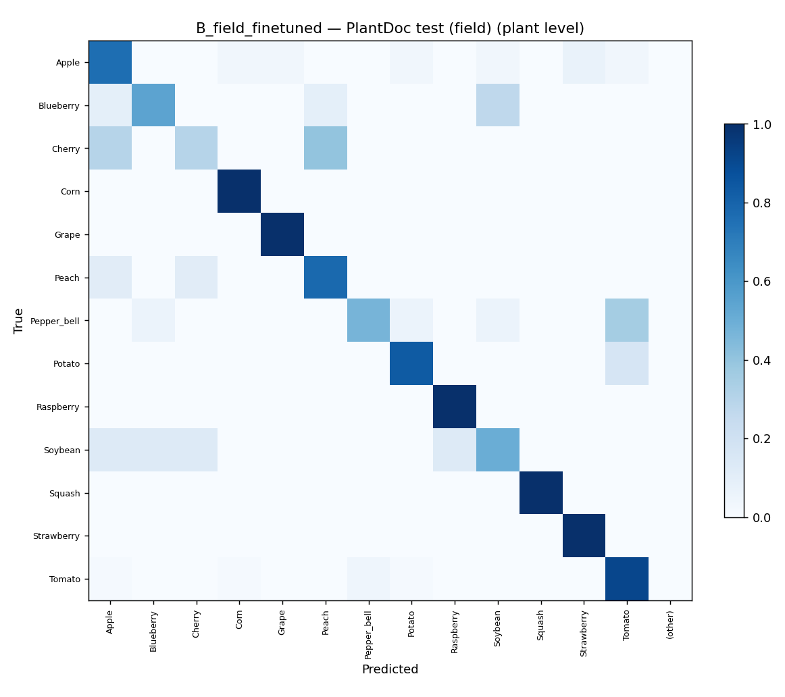
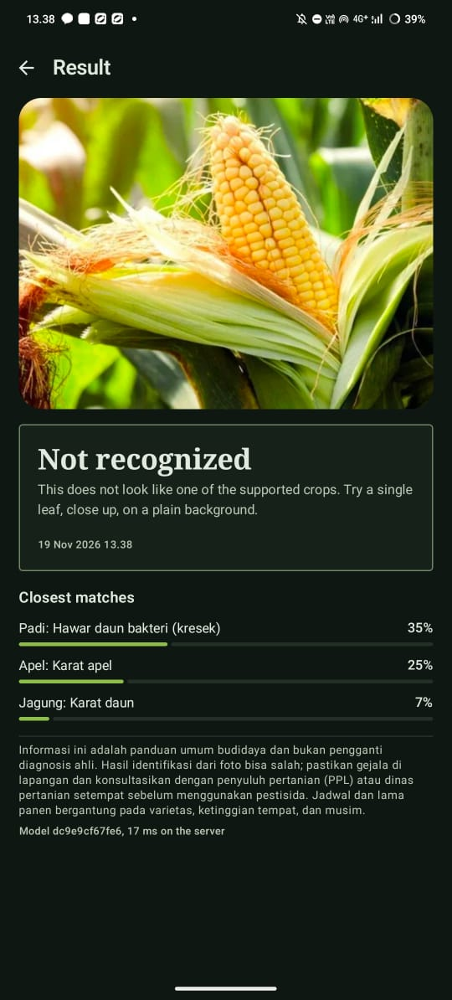
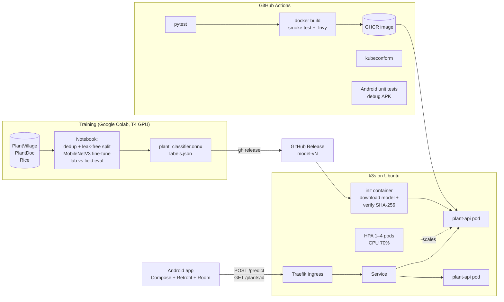

# Plant Identifier

[](https://github.com/lenohutapea/plant-identifier/actions/workflows/api.yml)
[](https://github.com/lenohutapea/plant-identifier/actions/workflows/k8s.yml)
[](https://github.com/lenohutapea/plant-identifier/actions/workflows/android.yml)
[](LICENSE)

Take a photo of a crop leaf on an Android phone and get the **plant**, its **leaf condition**
(healthy or which disease) and **care information in Indonesian**: how to plant, water, fertilizer,
harvest time, a planting schedule in days after planting (HST), and how to treat the disease.

It is an end-to-end project covering **computer vision** (training, honest evaluation, ONNX export),
a **production-style API** (FastAPI + ONNX Runtime, tests, metrics) and **DevOps**
(non-root container, CI/CD to GHCR, k3s with Traefik and autoscaling, load testing).

<p align="center">
  
  
  
</p>

**Status:** complete for portfolio use. model-v2 (15 crops, 41 classes) is deployed on k3s; the Android APK is
built by CI. Known gaps are listed under [Limitations](#limitations) and [Next steps](#next-steps).

## The main finding: lab accuracy is not field accuracy

Most public plant-disease models are trained on **PlantVillage**: single leaves photographed on a plain
background in a lab. They score very high on PlantVillage's own test set and much lower on real photos
taken in the field. This project measures that gap and how much field data closes it:

- **Model A (lab only):** MobileNetV3-Large fine-tuned on PlantVillage only.
- **Model B (field fine-tuned):** Model A, then fine-tuned on PlantVillage + **PlantDoc** field photos +
  rice field photos, with field-style augmentation (crops, blur, lighting, JPEG artifacts, occlusion).

Both are evaluated on the same held-out sets, at disease level and plant level
(probabilities summed per crop).

<!-- RESULTS:START -->
Results of [model-v2](https://github.com/lenohutapea/plant-identifier/releases/tag/model-v2)
(15 crops, 41 classes). The PlantDoc field test set has 228 images in 27 classes; the rice test set has 99 images.

| Model | Test set | Plant accuracy | Disease accuracy | Disease top-3 | Disease macro-F1 |
|---|---|---:|---:|---:|---:|
| A — lab only | PlantVillage test (lab, 5,432 images) | 100.0% | 99.9% | 100.0% | 0.999 |
| A — lab only | **PlantDoc test (field)** | **55.7%** | **27.6%** | 45.2% | 0.249 |
| B — field fine-tuned | PlantVillage test (lab, 5,432 images) | 100.0% | 99.7% | 100.0% | 0.997 |
| B — field fine-tuned | **PlantDoc test (field)** | **85.5%** | **69.3%** | **91.7%** | 0.685 |
| B — field fine-tuned | Rice test (field) | 96.0% | 85.9% | 93.9% | 0.873 |

- A model that is 99.9% accurate on lab photos gets only **27.6%** of real field photos right.
- Fine-tuning with field photos **raises field accuracy to 69.3%** while lab accuracy stays at 99.7%.
  The correct disease is in the top 3 for 91.7% of field photos, which is why the app shows the top 3.
- Plant-level accuracy in the field (85.5%) is much higher than disease-level accuracy: the app can
  usually name the crop even when the disease is uncertain.
- Rice results come from one small dataset (one source), so they are likely optimistic for photos from
  other paddies.
- Weakest field classes: Tomato bacterial spot and mosaic virus (often confused with Septoria leaf spot),
  corn leaf diseases (confused with each other) and cherry leaves (confused with peach and apple).

**How much to trust these numbers.** The same data and settings trained twice gave field disease accuracy
of 64.0% and 69.7% (GPU nondeterminism, small test set: about ±6 points of uncertainty). Differences of that
size between versions are noise, not progress:

| Run | Classes | Field plant accuracy | Field disease accuracy | Field top-3 |
|---|---:|---:|---:|---:|
| model-v1 | 38 | 81.6% | 64.0% | 90.8% |
| same setup as v1, second run (not released) | 38 | 82.0% | 69.7% | 89.9% |
| model-v2 (adds rice) | 41 | 85.5% | 69.3% | 91.7% |


<details>
<summary>Field confusion matrices (plant level), before and after fine-tuning</summary>




</details>

Dataset hygiene for this run: 18 images with conflicting labels and 169 duplicate copies removed (mostly
re-uploaded rice images); 994 training images that were near-duplicates of validation or test images dropped.

### Choosing the "not recognized" threshold

The API names a plant only when its probability is at least `PLANT_MIN_CONFIDENCE`. The notebook measures the
trade-off on the PlantDoc **validation** set (field photos, never the test set):

| Threshold | Field photos answered | Accuracy when answered | Wrong answers |
|---:|---:|---:|---:|
| 0.5 | 92.5% | 89.1% | 10.1% |
| 0.6 | 87.4% | 91.4% | 7.5% |
| **0.7 (deployed)** | **81.0%** | **94.3%** | **4.6%** |
| 0.8 | 69.8% | 96.7% | 2.3% |
| 0.9 | 44.0% | 98.0% | 0.9% |

0.7 halves the wrong answers compared with 0.5 while still answering four out of five field photos; on lab and
rice photos it still answers 95–100% of them with no errors. It only measures plants the model knows: leaves of
other species are filtered better but not reliably, which is what the planned "other" class addresses.

## Model versions

Models are published as GitHub Releases, never baked into the image. Switching versions is a one-line ConfigMap
change; the init container downloads the release and refuses a file whose SHA-256 does not match `labels.json`.

| Release | What changed | Classes |
|---|---|---:|
| [model-v0-dummy](https://github.com/lenohutapea/plant-identifier/releases/tag/model-v0-dummy) | Stand-in with the real input/output contract, to build the pipeline before training | 41 |
| [model-v1](https://github.com/lenohutapea/plant-identifier/releases/tag/model-v1) | First trained model: PlantVillage + PlantDoc | 38 |
| [model-v2](https://github.com/lenohutapea/plant-identifier/releases/tag/model-v2) | Adds rice; resumable training with Drive checkpoints; threshold calibration | 41 |

```bash
# deploy or roll back: point MODEL_BASE_URL at another release, then restart
sed -i 's#download/model-v2#download/model-v1#' deploy/k8s/configmap.yaml
kubectl apply -k deploy/k8s && kubectl -n plant-identifier rollout restart deploy/plant-api
```
<!-- RESULTS:END -->

Per-class F1 before/after, confusion matrices, training curves and the threshold calibration table are produced
by the notebook (`eval/` in the training artifacts, attached to each
[model release](https://github.com/lenohutapea/plant-identifier/releases)).

## Android app

| Home | Result | Not recognized | History |
|---|---|---|---|
|  |  |  |  |

Kotlin + Jetpack Compose, MVVM, Retrofit, Room.

- **Home:** take a photo or pick one from the gallery. Below that are recent diagnoses and the list of
  plants the server's current model recognizes (read from `GET /plants`, so it follows model updates).
- **Analyzing:** the photo is shown full screen with a scanning line while the request runs.
- **Result:** a specimen-style label with the plant name, Latin name, confidence and a color-coded leaf
  condition (healthy, disease, uncertain, not assessed). Three tabs:
  - **Diagnosis:** symptoms, treatment, prevention, top-3 predictions.
  - **Care:** planting, watering, fertilizer, harvest, notes for Indonesia.
  - **Schedule:** a timeline in days after planting (HST).
  Photos the model is not confident about are answered with **Not recognized** and the closest matches,
  instead of a wrong diagnosis.
- **History:** every diagnosis is stored locally with the full API response, so it opens offline.
  Entries can be deleted.
- **Settings:** the server address can be changed in the app (for example when the server's IP changes),
  without rebuilding.

Photos are resized to 1024 px before upload. Cleartext HTTP is allowed only for `*.nip.io`, the emulator
host and localhost. CI runs the unit tests, builds the debug APK on every push and publishes it to the
[android-latest pre-release](https://github.com/lenohutapea/plant-identifier/releases/tag/android-latest).

## Field testing on a phone

Beyond the benchmark test sets, the app was tried on a real phone. These are informal checks (a few photos
per plant, no ground-truth disease labels), not a benchmark.

**model-v2, threshold 0.7.** Most photos were internet images photographed off a laptop screen.

| Photo | App answer | Verdict |
|---|---|---|
| Tomato, strawberry, peach and grape leaves | Correct plant, healthy (86–97%) | Correct |
| Rice, squash, soybean and raspberry | Correct plant, "condition not assessed" | Correct (no condition data for these, by design) |
| Corn leaf | Corn, "leaf blight" at 52% | Plant correct; condition not verified |
| Corn cob (not a leaf) | Not recognized (best guess 35%) | Correct refusal |
| Orange, bell pepper, potato, apple, blueberry and cherry leaves | Often a wrong plant or "not recognized" | **Weak** |

Why the weak group fails:

- **Healthy orange leaves never appear in the training data.** The only orange class is citrus greening, so
  the model cannot recognize a healthy orange leaf.
- Bell pepper, potato, apple, cherry and blueberry have few or no field photos (mostly PlantVillage lab
  photos), and their leaves look alike.
- **Photographing a screen** adds moiré patterns, a pixel grid, glare and a color shift that the model never
  saw in training. Stock images on white backgrounds are also unlike both lab and field photos. Choosing the
  saved image from the gallery, or photographing a real leaf, is a fairer test.

**Earlier, model-v1 at threshold 0.5:**

| Photo | Truth | App answer | Verdict |
|---|---|---|---|
| Chili leaves (3 photos) | Chili (*Capsicum*) | Bell pepper, healthy, 51–77% | Closest supported relative: same genus |
| Potato plant (stock photo) | Potato | Soybean, healthy, 65% | **Wrong**, and would now be "not recognized" at 0.7 |

What this shows:

- The model is **closed-set**: it must choose one of its 15 crops. The 0.7 threshold turns many wrong answers
  into "not recognized" but cannot catch all of them. A leaf of an unsupported species can still land on a
  similar crop with high confidence.
- For chili this is useful: the class is labeled "Paprika / Cabai". For other unsupported plants it is a
  wrong answer, which is what the planned "other" class addresses.

## Architecture



Design choices worth noting:

- **The model is not baked into the image.** An init container downloads `plant_classifier.onnx` and
  `labels.json` from a GitHub Release and checks the SHA-256 recorded in `labels.json`. Shipping a new
  model is a one-line ConfigMap change; the image stays the same.
- **The API refuses to start** if the model and `labels.json` come from different training runs (checksum),
  or if `plants.json` has no care information for a class the model can predict.
- **Plant first, disease second.** The plant probability is the sum of its classes' probabilities, so the
  app can name the plant confidently even when it is unsure about the disease. Leaf condition is only
  reported for plants whose training data has both healthy and diseased leaves.
- **Leak-free evaluation.** Exact duplicates (MD5) and near duplicates (64-bit dHash, Hamming ≤ 4) are
  grouped so the same photo never appears in both train and test; PlantDoc's known train/test overlap is
  removed. Rice photos that are rotated copies of each other are kept in the same split.

## Supported plants

model-v2 recognizes 15 crops and 41 classes (`Plant___Condition`).

| Plant | Conditions | Condition reported? |
|---|---|---|
| Apple (Apel) | Scab, Black rot, Cedar apple rust, Healthy | Yes |
| Cherry (Ceri) | Powdery mildew, Healthy | Yes |
| Corn (Jagung) | Gray leaf spot, Common rust, Northern leaf blight, Healthy | Yes |
| Grape (Anggur) | Black rot, Esca, Leaf blight, Healthy | Yes |
| Peach (Persik) | Bacterial spot, Healthy | Yes |
| Bell pepper / chili (Paprika / Cabai) | Bacterial spot, Healthy | Yes — chili leaves are recognized as this class |
| Potato (Kentang) | Early blight, Late blight, Healthy | Yes |
| Strawberry (Stroberi) | Leaf scorch, Healthy | Yes |
| Tomato (Tomat) | 9 diseases + Healthy | Yes |
| Orange (Jeruk) | Citrus greening (CVPD) only | No — no healthy class |
| Squash (Labu) | Powdery mildew only | No — no healthy class |
| Rice (Padi) | Bacterial leaf blight, Blast, Brown spot | No — no healthy class |
| Blueberry, Raspberry, Soybean (Kedelai) | Healthy only | No — no disease class |

For the last six the app shows the plant and its care information, and says the leaf condition cannot be
assessed, instead of giving a diagnosis that the data cannot support.

## Repository layout

| Path | Contents |
|---|---|
| `notebooks/train_plant_classifier.ipynb` | Colab notebook: download, label mapping, dedup, split, training, evaluation, ONNX export |
| `api/` | FastAPI + ONNX Runtime service, `plants.json` (Indonesian care info), pytest suite, Dockerfile |
| `deploy/k8s/` | Kustomize manifests: Deployment (init container), Service, Traefik Ingress, HPA |
| `loadtest/` | k6 load test for `POST /predict` |
| `android/` | Kotlin + Jetpack Compose app (MVVM, Retrofit, Room) |
| `.github/workflows/` | CI for API, Kubernetes manifests and Android; Dependabot config |

## Running it

**Train the model** — open the notebook in Colab (`File → Open notebook → GitHub`), choose a T4 GPU,
then `Run all` (about 60–90 minutes). Optional Colab secrets `KAGGLE_USERNAME` / `KAGGLE_KEY` add rice.

**API locally**

```bash
cd api
python3 -m venv .venv && source .venv/bin/activate
pip install -r requirements-dev.txt
pytest
python -m tests.dummy_model models/      # or copy plant_classifier.onnx + labels.json into models/
uvicorn app.main:app --reload            # http://localhost:8000/docs
```

**Docker**

```bash
docker run -p 8000:8000 -v "$PWD/api/models:/app/models:ro" ghcr.io/lenohutapea/plant-identifier-api:latest
```

**k3s**

```bash
kubectl apply -k deploy/k8s
kubectl -n plant-identifier rollout status deploy/plant-api
curl http://plant-api.<node-ip>.nip.io/readyz
```

Change the host in `deploy/k8s/ingress.yaml` and the model release in `deploy/k8s/configmap.yaml`.

**Load test**

```bash
docker run --rm -i --network host -v "$PWD/loadtest:/scripts" grafana/k6 run /scripts/predict.js
```

**Android** — download the debug APK from the
[android-latest pre-release](https://github.com/lenohutapea/plant-identifier/releases/tag/android-latest), or open
`android/` in Android Studio and run. The default API address is `apiBaseUrl` in `android/gradle.properties`;
it can also be changed in the app's Settings screen.

## API

| Method | Path | Description |
|---|---|---|
| POST | `/predict` | Multipart field `image`; returns plant, condition, `condition_status`, top-3 classes, top-3 plants |
| GET | `/plants` | Plants the loaded model recognizes |
| GET | `/plants/{plant_id}` | Care information in Indonesian |
| GET | `/healthz`, `/readyz` | Liveness / readiness (503 until the model is loaded) |
| GET | `/metrics` | Prometheus metrics: requests, latency, inference time, predictions per plant |

`condition_status` is one of `assessed`, `uncertain` (best condition guess below `CONDITION_MIN_CONFIDENCE`,
0.5), `not_supported` (see the table above) or `unrecognized` (no plant reaches `PLANT_MIN_CONFIDENCE`, 0.7 in
the k3s deployment). Details in [`api/README.md`](api/README.md).

## Performance

<!-- LOADTEST:START -->
k6 load test against `POST /predict` through Traefik on a single-node k3s (Ubuntu VM, 4 vCPU, 5.8 GB RAM),
model-v1 (same architecture and input size as model-v2), 640x480 JPEG, ramping to 20 virtual users that each wait 0.5 s between requests (4 minutes):

| Metric | Result |
|---|---|
| Requests | 6,716 (about 28/s), 0 errors |
| Latency median / p90 / p95 | 17 ms / 28 ms / 34 ms |
| Latency max | 145 ms (while new pods were starting) |
| Autoscaling | CPU reached 161% of the 70% target; HPA scaled from 1 to 3 pods |

Each pod runs ONNX Runtime with one inference thread and a 1-CPU limit. The request rate is set by the
test scenario (20 users with a 0.5 s pause), not by the server, so this shows latency and autoscaling
under load rather than maximum throughput.
<!-- LOADTEST:END -->

## Limitations

- **15 crops only.** Many crops common in Indonesia — cassava, cocoa, coffee, sweet potato, local chili such
  as cabai rawit — are not in the datasets. A photo of them is "not recognized" at best and misclassified at
  worst (see Field testing). Chili has no class of its own; its leaves are recognized as bell pepper (same
  genus), and disease diagnosis on chili is untested.
- **The model is closed-set.** There is no "other plant / not a leaf" class yet; the confidence threshold is
  the only guard against out-of-scope photos.
- **Healthy orange leaves cannot be recognized:** the data has only diseased (citrus greening) orange leaves.
- **Field accuracy is lower than lab accuracy**, even after fine-tuning; see the results table. PlantDoc is
  small (about 2,600 images) and has no field photos for some classes (for example Orange, Tomato target
  spot, Grape esca), which are therefore evaluated on lab photos only. Bell pepper, potato, apple, cherry and
  blueberry were the weakest in phone testing.
- **Photos of a screen and stock images work worse** than photos of real leaves (moiré, glare, color shift,
  artificial backgrounds).
- **Six crops have no condition diagnosis** because their data has only one condition (see Supported plants).
  Rice in particular has no healthy class.
- **Label approximations:** PlantDoc's "Corn leaf blight" is mapped to Northern leaf blight, and
  "&lt;plant&gt; leaf" folders are treated as healthy.
- **Rice data is small** (about 470 images from a single source), so rice results are likely optimistic.
- **Care information is general guidance** written for this project, not reviewed by an agronomist.
  Pesticides are named by active ingredient only; always follow the product label and consult a local
  extension officer (PPL).
- **The API runs over plain HTTP on the local network.** Exposing it publicly would need TLS
  (for example cert-manager), authentication and rate limiting.

## Next steps

- **model-v3:**
  - an explicit "other plant / not a leaf" class trained on out-of-scope images;
  - healthy citrus leaves from an openly licensed dataset;
  - screen-photo augmentation (moiré, color shift, glare).
- **More field photos** for the weak crops, ideally photographed locally in North Sumatra.
- **Observability:** a Prometheus + Grafana dashboard for the metrics the API already exposes.
- **GitOps:** deploy from the repository with Argo CD instead of `kubectl apply`.

## Datasets and citations

| Dataset | Use here | License |
|---|---|---|
| [PlantVillage](https://github.com/spMohanty/PlantVillage-Dataset) — about 54,000 lab images, 38 classes | Training (A and B), lab test set | CC BY-SA 3.0 |
| [PlantDoc](https://github.com/pratikkayal/PlantDoc-Dataset) — 2,598 field images | Fine-tuning (B), field test set | CC BY 4.0 |
| [Rice Disease Dataset](https://www.kaggle.com/datasets/nischallal/rice-disease-dataset) — about 470 field images | Adds rice (model-v2) | CC0 1.0 |

```bibtex
@article{hughes2015plantvillage,
  title   = {An open access repository of images on plant health to enable the development of mobile disease diagnostics},
  author  = {Hughes, David P. and Salath{\'e}, Marcel},
  journal = {arXiv preprint arXiv:1511.08060},
  year    = {2015}
}

@inproceedings{singh2020plantdoc,
  title     = {PlantDoc: A Dataset for Visual Plant Disease Detection},
  author    = {Singh, Davinder and Jain, Naman and Jain, Pranjali and Kayal, Pratik and Kumawat, Sudhakar and Batra, Nipun},
  booktitle = {Proceedings of the 7th ACM IKDD CoDS and 25th COMAD},
  pages     = {249--253},
  year      = {2020},
  doi       = {10.1145/3371158.3371196}
}

@misc{shrestha2021rice,
  title     = {Rice Disease Dataset},
  author    = {Shrestha, Nischal Lal and Pandey, Poshan and Tiwari, Ashish and Giri, Rezina},
  publisher = {Kaggle},
  year      = {2021},
  doi       = {10.34740/KAGGLE/DSV/2481060},
  url       = {https://www.kaggle.com/dsv/2481060}
}
```

## License

Because the model is trained on PlantVillage (CC BY-SA 3.0), this repository — code, model weights and
care-information data — is released under **[CC BY-SA 4.0](LICENSE)** (share-alike, permitted as a later
version of 3.0). The datasets keep their own licenses listed above.

## Author

Angeleno Zuliano Hutapea — D3 Teknologi Komputer, Institut Teknologi Del ·
[github.com/lenohutapea](https://github.com/lenohutapea)
