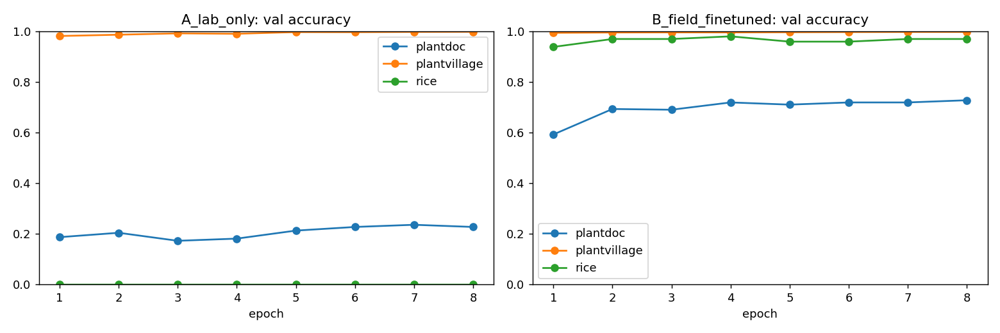
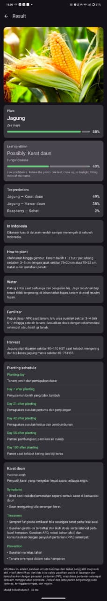
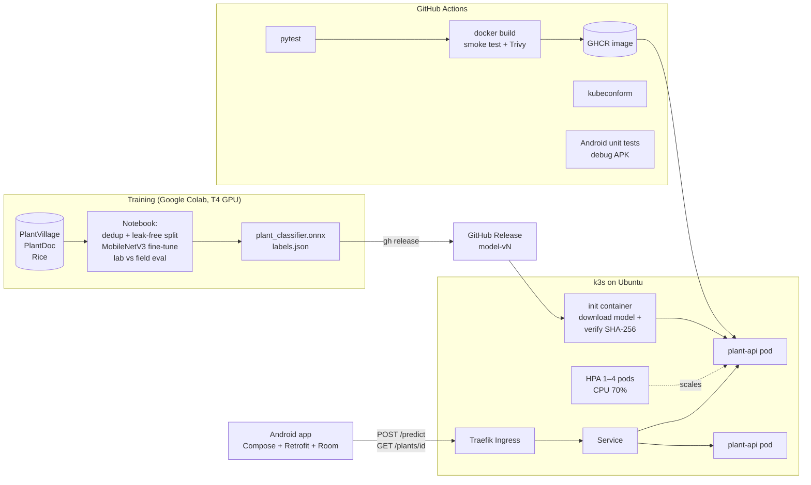

# Plant Identifier

[](https://github.com/lenohutapea/plant-identifier/actions/workflows/api.yml)
[](https://github.com/lenohutapea/plant-identifier/actions/workflows/k8s.yml)
[](https://github.com/lenohutapea/plant-identifier/actions/workflows/android.yml)
[](LICENSE)

Take a photo of a crop leaf on an Android phone and get the **plant**, its **leaf condition**
(healthy or which disease) and **care information in Indonesian**: how to plant, water, fertilizer,
harvest time, a planting schedule in days after planting (HST), and how to treat the disease.

It is an end-to-end project covering **computer vision** (training, honest evaluation, ONNX export),
a **production-style API** (FastAPI + ONNX Runtime, tests, metrics) and **DevOps**
(non-root container, CI/CD to GHCR, k3s with Traefik and autoscaling, load testing).

<!-- Screenshots: add after the Android build, e.g. docs/screenshots/home.png, result.png, history.png -->

## The main finding: lab accuracy is not field accuracy

Most public plant-disease models are trained on **PlantVillage**: single leaves photographed on a plain
background in a lab. They score very high on PlantVillage's own test set and much lower on real photos
taken in the field. This project measures that gap and how much field data closes it:

- **Model A (lab only):** MobileNetV3-Large fine-tuned on PlantVillage only.
- **Model B (field fine-tuned):** Model A, then fine-tuned on PlantVillage + **PlantDoc** field photos +
  rice field photos, with field-style augmentation (crops, blur, lighting, JPEG artifacts, occlusion).

Both are evaluated on the same held-out sets, at disease level and plant level
(probabilities summed per crop).

<!-- RESULTS:START -->
Results of [model-v1](https://github.com/lenohutapea/plant-identifier/releases/tag/model-v1)
(14 crops, 38 classes; the PlantDoc field test set has 228 images in 27 classes):

| Model | Test set | Plant accuracy | Disease accuracy | Disease top-3 | Disease macro-F1 |
|---|---|---:|---:|---:|---:|
| A — lab only | PlantVillage test (lab, 5,432 images) | 100.0% | 99.9% | 100.0% | 0.999 |
| A — lab only | **PlantDoc test (field)** | **54.8%** | **30.7%** | 45.6% | 0.287 |
| B — field fine-tuned | PlantVillage test (lab, 5,432 images) | 100.0% | 99.7% | 100.0% | 0.995 |
| B — field fine-tuned | **PlantDoc test (field)** | **81.6%** | **64.0%** | **90.8%** | 0.627 |

- A model that is 99.9% accurate on lab photos gets **30.7%** of real field photos right.
- Fine-tuning with field photos **doubles field accuracy to 64.0%** while lab accuracy stays at 99.7%.
  The correct disease is in the top 3 for 90.8% of field photos, which is why the app shows the top 3.
- Plant-level accuracy in the field (81.6%) is much higher than disease-level accuracy: the app can
  usually name the crop even when the disease is uncertain.
- The field test set is small (3–12 images per class), so field accuracy carries roughly ±6 percentage
  points of uncertainty and per-class numbers are rough.
- Weakest field classes after fine-tuning: Tomato mosaic virus (F1 0.17) and Tomato bacterial spot (0.20),
  both often confused with Septoria leaf spot; Cherry leaves are confused with Peach and Apple.



<details>
<summary>Field confusion matrices (plant level), before and after fine-tuning</summary>


</details>

Dataset hygiene for this run: 18 images with conflicting labels and 24 duplicate copies removed;
971 training images that were near-duplicates of validation or test images were dropped.
<!-- RESULTS:END -->

Per-class F1 before/after, confusion matrices and training curves are produced by the notebook
(`eval/` in the training artifacts, attached to the [model-v1 release](https://github.com/lenohutapea/plant-identifier/releases)).

## Android app

| Home | Result | History |
|---|---|---|
|  |  |  |

Kotlin + Jetpack Compose (MVVM, Retrofit, Room). Photos from the camera or gallery are resized to 1024 px
before upload; every diagnosis is stored locally with the full API response so history opens offline.
CI builds the debug APK on every push and publishes it to the
[android-latest pre-release](https://github.com/lenohutapea/plant-identifier/releases/tag/android-latest).

## Field testing on a phone

Photos taken or picked on a real phone with model-v1, beyond the benchmark test sets:

| Photo | Truth | App answer | Confidence | Verdict |
|---|---|---|---:|---|
| Corn cob in the field (not a leaf) | Corn | Corn; condition "possibly common rust", flagged low confidence | 88% plant, 49% condition | Plant correct; uncertainty shown honestly |
| Chili leaves (3 photos) | Chili (*Capsicum*) | Bell pepper, healthy | 51–77% | Closest supported relative: same genus |
| Potato plant (stock photo, transparent background) | Potato | Soybean, healthy | 65% | **Wrong** |

What this shows:

- The model is **closed-set**: it must pick one of its 14 crops, so a leaf it has never seen is mapped to the
  most similar one. For chili this is useful (the app now labels the class "Paprika / Cabai"); for other
  plants it is a wrong answer delivered with moderate confidence.
- Healthy potato has the fewest examples in the training data (about 150 lab photos, no field photos), which
  matches the potato miss.
- Planned fixes: choose the "not recognized" threshold from the validation calibration table that the
  notebook now produces, and train an explicit **"other plant / not a leaf"** class with out-of-scope images.

## Architecture



Design choices worth noting:

- **The model is not baked into the image.** An init container downloads `plant_classifier.onnx` and
  `labels.json` from a GitHub Release and checks the SHA-256 recorded in `labels.json`. Shipping a new
  model is a one-line ConfigMap change; the image stays the same.
- **The API refuses to start** if the model and `labels.json` come from different training runs (checksum),
  or if `plants.json` has no care information for a class the model can predict.
- **Plant first, disease second.** The plant probability is the sum of its classes' probabilities, so the
  app can name the plant confidently even when it is unsure about the disease. Leaf condition is only
  reported for plants whose training data has both healthy and diseased leaves.
- **Leak-free evaluation.** Exact duplicates (MD5) and near duplicates (64-bit dHash, Hamming ≤ 4) are
  grouped so the same photo never appears in both train and test; PlantDoc's known train/test overlap is
  removed. Rice photos that are rotated copies of each other are kept in the same split.

## Supported plants

model-v1 recognizes 14 crops and 38 classes (`Plant___Condition`). Rice (3 classes) has care
information in the API already and is planned for model-v2.

| Plant | Conditions | Condition reported? |
|---|---|---|
| Apple (Apel) | Scab, Black rot, Cedar apple rust, Healthy | Yes |
| Cherry (Ceri) | Powdery mildew, Healthy | Yes |
| Corn (Jagung) | Gray leaf spot, Common rust, Northern leaf blight, Healthy | Yes |
| Grape (Anggur) | Black rot, Esca, Leaf blight, Healthy | Yes |
| Peach (Persik) | Bacterial spot, Healthy | Yes |
| Bell pepper / chili (Paprika / Cabai) | Bacterial spot, Healthy | Yes — chili leaves are recognized as this class |
| Potato (Kentang) | Early blight, Late blight, Healthy | Yes |
| Strawberry (Stroberi) | Leaf scorch, Healthy | Yes |
| Tomato (Tomat) | 9 diseases + Healthy | Yes |
| Orange (Jeruk) | Citrus greening (CVPD) only | No — no healthy class |
| Squash (Labu) | Powdery mildew only | No — no healthy class |
| Rice (Padi) — planned for model-v2 | Bacterial leaf blight, Blast, Brown spot | No — no healthy class |
| Blueberry, Raspberry, Soybean (Kedelai) | Healthy only | No — no disease class |

For the last six the app shows the plant and its care information, and says the leaf condition cannot be
assessed, instead of giving a diagnosis that the data cannot support.

## Repository layout

| Path | Contents |
|---|---|
| `notebooks/train_plant_classifier.ipynb` | Colab notebook: download, label mapping, dedup, split, training, evaluation, ONNX export |
| `api/` | FastAPI + ONNX Runtime service, `plants.json` (Indonesian care info), pytest suite, Dockerfile |
| `deploy/k8s/` | Kustomize manifests: Deployment (init container), Service, Traefik Ingress, HPA |
| `loadtest/` | k6 load test for `POST /predict` |
| `android/` | Kotlin + Jetpack Compose app (MVVM, Retrofit, Room) |
| `.github/workflows/` | CI for API, Kubernetes manifests and Android; Dependabot config |

## Running it

**Train the model** — open the notebook in Colab (`File → Open notebook → GitHub`), choose a T4 GPU,
then `Run all` (about 60–90 minutes). Optional Colab secrets `KAGGLE_USERNAME` / `KAGGLE_KEY` add rice.

**API locally**

```bash
cd api
python3 -m venv .venv && source .venv/bin/activate
pip install -r requirements-dev.txt
pytest
python -m tests.dummy_model models/      # or copy plant_classifier.onnx + labels.json into models/
uvicorn app.main:app --reload            # http://localhost:8000/docs
```

**Docker**

```bash
docker run -p 8000:8000 -v "$PWD/api/models:/app/models:ro" ghcr.io/lenohutapea/plant-identifier-api:latest
```

**k3s**

```bash
kubectl apply -k deploy/k8s
kubectl -n plant-identifier rollout status deploy/plant-api
curl http://plant-api.<node-ip>.nip.io/readyz
```

Change the host in `deploy/k8s/ingress.yaml` and the model release in `deploy/k8s/configmap.yaml`.

**Load test**

```bash
docker run --rm -i --network host -v "$PWD/loadtest:/scripts" grafana/k6 run /scripts/predict.js
```

**Android** — open `android/` in Android Studio and run, or download the debug APK from the latest
`android` workflow run. The API address is `apiBaseUrl` in `android/gradle.properties`.

## API

| Method | Path | Description |
|---|---|---|
| POST | `/predict` | Multipart field `image`; returns plant, condition, `condition_status`, top-3 classes, top-3 plants |
| GET | `/plants` | Plants the loaded model recognizes |
| GET | `/plants/{plant_id}` | Care information in Indonesian |
| GET | `/healthz`, `/readyz` | Liveness / readiness (503 until the model is loaded) |
| GET | `/metrics` | Prometheus metrics: requests, latency, inference time, predictions per plant |

`condition_status` is one of `assessed`, `uncertain` (best guess below 50%), `not_supported` (see the
table above) or `unrecognized` (no plant above 50%). Details in [`api/README.md`](api/README.md).

## Performance

<!-- LOADTEST:START -->
k6 load test against `POST /predict` through Traefik on a single-node k3s (Ubuntu VM, 4 vCPU, 5.8 GB RAM),
model-v1, 640x480 JPEG, ramping to 20 virtual users that each wait 0.5 s between requests (4 minutes):

| Metric | Result |
|---|---|
| Requests | 6,716 (about 28/s), 0 errors |
| Latency median / p90 / p95 | 17 ms / 28 ms / 34 ms |
| Latency max | 145 ms (while new pods were starting) |
| Autoscaling | CPU reached 161% of the 70% target; HPA scaled from 1 to 3 pods |

Each pod runs ONNX Runtime with one inference thread and a 1-CPU limit. The request rate is set by the
test scenario (20 users with a 0.5 s pause), not by the server, so this shows latency and autoscaling
under load rather than maximum throughput.
<!-- LOADTEST:END -->

## Limitations

- **14 crops only (rice follows in model-v2).** Many crops common in Indonesia — cassava, cocoa, coffee,
  sweet potato — are not in the datasets, and a photo of them will be "not recognized" at best or
  misclassified at worst (see Field testing). Chili has no class of its own; its leaves are recognized as
  bell pepper (same genus), and disease diagnosis on chili is untested.
- **Field accuracy is lower than lab accuracy**, even after fine-tuning; see the results table. PlantDoc is
  small (about 2,600 images) and has no field photos for some classes (for example Orange, Tomato target
  spot, Grape esca), which are therefore evaluated on lab photos only.
- **Six crops have no condition diagnosis** because their data has only one condition (see above). Rice in
  particular has no healthy class.
- **Label approximations:** PlantDoc's "Corn leaf blight" is mapped to Northern leaf blight, and
  "&lt;plant&gt; leaf" folders are treated as healthy.
- **Rice data is small** (about 470 images, originally a detection dataset with augmented copies).
- **Care information is general guidance** written for this project, not reviewed by an agronomist.
  Pesticides are named by active ingredient only; always follow the product label and consult a local
  extension officer (PPL).
- **The API runs over plain HTTP on the local network.** Exposing it publicly would need TLS
  (for example cert-manager) and rate limiting.

## Datasets and citations

| Dataset | Use here | License |
|---|---|---|
| [PlantVillage](https://github.com/spMohanty/PlantVillage-Dataset) — about 54,000 lab images, 38 classes | Training (A and B), lab test set | CC BY-SA 3.0 |
| [PlantDoc](https://github.com/pratikkayal/PlantDoc-Dataset) — 2,598 field images | Fine-tuning (B), field test set | CC BY 4.0 |
| [Rice Disease Dataset](https://www.kaggle.com/datasets/nischallal/rice-disease-dataset) — about 470 field images | Adds rice (planned for model-v2) | CC0 1.0 |

```bibtex
@article{hughes2015plantvillage,
  title   = {An open access repository of images on plant health to enable the development of mobile disease diagnostics},
  author  = {Hughes, David P. and Salath{\'e}, Marcel},
  journal = {arXiv preprint arXiv:1511.08060},
  year    = {2015}
}

@inproceedings{singh2020plantdoc,
  title     = {PlantDoc: A Dataset for Visual Plant Disease Detection},
  author    = {Singh, Davinder and Jain, Naman and Jain, Pranjali and Kayal, Pratik and Kumawat, Sudhakar and Batra, Nipun},
  booktitle = {Proceedings of the 7th ACM IKDD CoDS and 25th COMAD},
  pages     = {249--253},
  year      = {2020},
  doi       = {10.1145/3371158.3371196}
}

@misc{shrestha2021rice,
  title     = {Rice Disease Dataset},
  author    = {Shrestha, Nischal Lal and Pandey, Poshan and Tiwari, Ashish and Giri, Rezina},
  publisher = {Kaggle},
  year      = {2021},
  doi       = {10.34740/KAGGLE/DSV/2481060},
  url       = {https://www.kaggle.com/dsv/2481060}
}
```

## License

Because the model is trained on PlantVillage (CC BY-SA 3.0), this repository — code, model weights and
care-information data — is released under **[CC BY-SA 4.0](LICENSE)** (share-alike, permitted as a later
version of 3.0). The datasets keep their own licenses listed above.

## Author

Angeleno Zuliano Hutapea — D3 Teknologi Komputer, Institut Teknologi Del ·
[github.com/lenohutapea](https://github.com/lenohutapea)
